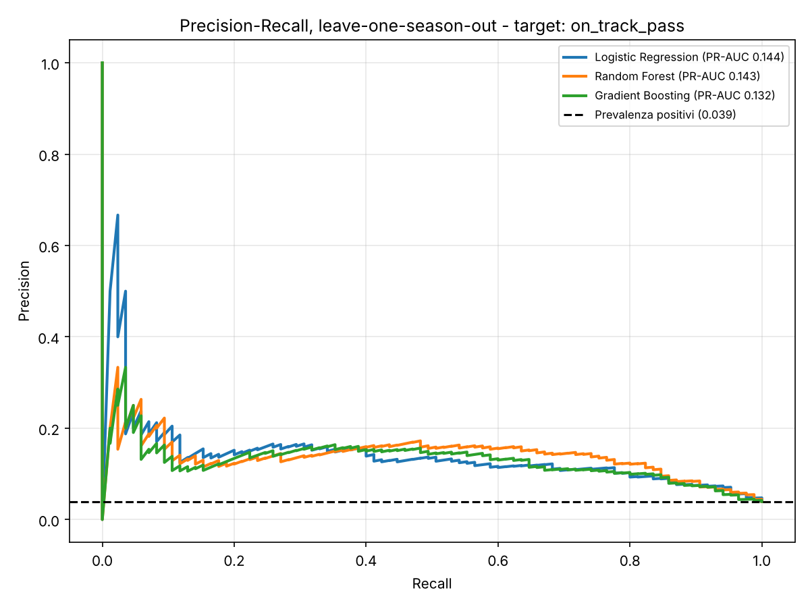

# F1 Overtake Prediction

<div align="center">


**Machine learning system that estimates overtaking probability in Formula 1**

*Machine Learning course project — University of Salerno, A.Y. 2025/26*

[Installation](#installation) •
[Usage](#usage) •
[Project Structure](#project-structure) •
[Methodology](#methodology) •
[Results](#results)

</div>

---

## Overview

This project predicts the probability that a driver overtakes the car ahead during a Formula 1 race. A Streamlit application simulates a **pit wall** at the 2025 Italian Grand Prix (Monza), letting engineers evaluate attack and defence scenarios.

### Key Features

- **Real data**: official F1 timing data via FastF1 (Monza 2022–2024)
- **Feature engineering**: pairwise attacker/defender metrics (lap-time delta, tyre age, compound advantage)
- **Model comparison**: Logistic Regression, Random Forest and XGBoost
- **Rigorous evaluation**: leave-one-season-out validation against a trivial baseline, with PR-AUC as the main metric
- **Label audit**: separates genuine on-track passes from position changes caused by pit stops
- **Web application**: interactive interface to simulate overtaking scenarios

---

## Installation

### Prerequisites

- Python 3.9 or later
- pip

### Setup

```bash
# Clone the repository
git clone https://github.com/af21-code/f1-overtake-prediction.git
cd f1-overtake-prediction

# Create a virtual environment
python -m venv .venv
source .venv/bin/activate  # Linux/macOS
# .venv\Scripts\activate   # Windows

# Install dependencies
pip install -r project/requirements.txt
```

---

## Usage

### 1. Run the full pipeline

**Option A — single command:**
```bash
cd project/src
python run_pipeline.py
```

**Option B — step by step:**
```bash
cd project/src

# Step 1: download data from FastF1 (requires an internet connection)
python pipeline/data_loader.py

# Step 2: build pairwise features
python pipeline/relative_feature_builder.py

# Step 3: preprocess the data
python pipeline/feature_processor.py

# Step 4: train and compare the models
python training/model_trainer.py

# Optional: leave-one-season-out evaluation and label audit
python training/robust_evaluation.py
```

### 2. Launch the web application

```bash
cd project/src/app
streamlit run app.py
```

The app runs at `http://localhost:8501`.

**How to use it:**

1. **Enter your driver's data**: position, tyre compound, tyre age, lap time
2. **Enter the opponent's data**: tyre compound, tyre age, lap time
3. **Set the gap** between the two drivers
4. **Click "CALCULATE PROBABILITY"** to get the prediction
5. Use **SWAP** to switch between ATTACK and DEFENSE mode

### 3. Team telemetry features (optional)

`analysis/team_lap_features.py` extracts top speed, full-throttle percentage and DRS-open percentage from FastF1 telemetry for a team's clean laps, as a starting point to extend the model beyond lap times and tyres:

```bash
cd project/src
python analysis/team_lap_features.py --year 2024 --gp Imola --team RB
```

---

## Project Structure

```
f1-overtake-prediction/
│
├── docs/                                  # Documentation
│   ├── report/
│   │   └── Machine Learning for Formula 1.pdf    # Project report
│   └── presentation/
│       └── F1 Predict AI - Presentation.pdf      # Presentation slides
│
├── project/                               # Source code and data
│   ├── data/
│   │   ├── f1_ground_effect_dataset.csv      # Raw lap data, Monza 2022–2024
│   │   ├── f1_monza_relative_features.csv    # Pairwise features
│   │   └── processed/                        # Training-ready arrays
│   │
│   ├── models/
│   │   ├── best_model.pkl                    # Trained model
│   │   ├── scaler.pkl                        # StandardScaler
│   │   ├── feature_names.pkl                 # Feature names
│   │   └── model_info.json                   # Model metadata
│   │
│   ├── reports/
│   │   ├── training_report.json              # Full metrics
│   │   ├── confusion_matrix_*.png            # Confusion matrices
│   │   ├── roc_curves.png                    # ROC curves
│   │   ├── feature_importance_*.png          # Feature importance
│   │   ├── correlation_analysis.png          # Correlation heatmap
│   │   ├── robust_evaluation.json / .md      # Season-level evaluation
│   │   └── pr_curves_*.png                   # Precision-Recall curves
│   │
│   ├── src/
│   │   ├── app/                              # Web application
│   │   │   ├── app.py                        # Streamlit app
│   │   │   └── style.css                     # Styles
│   │   │
│   │   ├── pipeline/                         # Data processing
│   │   │   ├── data_loader.py                # FastF1 download
│   │   │   ├── relative_feature_builder.py   # Pairwise feature construction
│   │   │   └── feature_processor.py          # Preprocessing and SMOTE
│   │   │
│   │   ├── training/                         # Model training
│   │   │   ├── model_trainer.py              # Training and evaluation
│   │   │   └── robust_evaluation.py          # Season-level evaluation + baseline
│   │   │
│   │   └── analysis/                         # Analysis scripts
│   │       ├── correlation_analysis.py       # Feature correlation
│   │       └── team_lap_features.py          # Team telemetry features (speed, throttle, DRS)
│   │
│   ├── notebooks/                            # Exploratory data analysis
│   ├── cache/                                # FastF1 cache (gitignored)
│   └── requirements.txt                      # Python dependencies
│
├── LICENSE                                # MIT License
└── README.md
```

---

## Methodology

### 1. Data collection

Data comes from **FastF1**, a Python library that exposes official Formula 1 timing and telemetry. The dataset covers the Italian Grand Prix at Monza in 2022, 2023 and 2024.

**Fields extracted for every lap:**
- `Driver`: driver code
- `LapNumber`: lap number
- `LapTime`: lap time
- `Position`: race position
- `TyreLife`: laps on the current tyre set
- `Compound`: tyre compound (SOFT/MEDIUM/HARD)

### 2. Feature engineering

An overtake depends on the duel between two cars, so the features are **relative** to the car ahead:

| Feature | Description |
|---------|-------------|
| `Delta_LapTime` | Lap-time difference (negative = attacker faster) |
| `Delta_TyreLife` | Tyre-age difference (negative = attacker on fresher tyres) |
| `Compound_Advantage` | Compound advantage (SOFT=3, MEDIUM=2, HARD=1) |
| `Attacker_Position` | Attacker's position |
| `Attacker_LapTime` | Attacker's lap time |
| `Attacker_TyreLife` | Attacker's tyre age |

**Target:** `IsOvertake` (1 if the attacker gains a position on the next lap).

### 3. Preprocessing

- **Outlier removal**: laps slower than mean + 2σ (pit stops, safety car) are dropped
- **Missing values**: filled with `0`
- **Scaling**: StandardScaler, fitted on the training set only
- **SMOTE**: synthetic oversampling of the minority class, applied to the training set only

### 4. Models

| Model | Configuration |
|-------|---------------|
| **Logistic Regression** | `class_weight='balanced'`, `max_iter=1000` |
| **Random Forest** | `n_estimators=100`, `class_weight='balanced'` |
| **XGBoost** | `eval_metric='logloss'` |

### 5. Evaluation metrics

- **Accuracy**: share of correct predictions
- **Precision**: TP / (TP + FP), reliability of positive predictions
- **Recall**: TP / (TP + FN), share of overtakes found
- **F1-score**: harmonic mean of precision and recall
- **ROC-AUC**: area under the ROC curve
- **PR-AUC**: area under the Precision-Recall curve; its reference value is the share of positives

The best model is selected by **PR-AUC**: with imbalanced classes, accuracy rewards a model that always predicts "no overtake".

---

## Results

### Season-level evaluation (leave-one-season-out)

`project/src/training/robust_evaluation.py` trains on two Monza races and tests on the third, rotating through 2022, 2023 and 2024. Metrics are computed on the pooled out-of-fold predictions and compared with a baseline that always predicts "no overtake". To keep results reproducible with scikit-learn only, class imbalance is handled with class weights and the gradient-boosting model is scikit-learn's `HistGradientBoostingClassifier`.

**Original target `position_gain`** (the attacker gains a position on the next lap): 2,392 pairs, 16.8% positives.

| Model | Accuracy | F1 | PR-AUC | ROC-AUC |
|---|---|---|---|---|
| Baseline: always "no overtake" | 0.832 | 0.000 | 0.168 | 0.500 |
| Logistic Regression | 0.687 | 0.401 | **0.451** | **0.723** |
| Random Forest | 0.747 | 0.381 | 0.424 | 0.706 |
| Gradient Boosting | 0.779 | 0.353 | 0.415 | 0.671 |

**Target `on_track_pass`** (the attacker passes that specific defender, and neither car pits in the next two laps): 2,161 pairs, 3.9% positives.

| Model | Accuracy | F1 | PR-AUC | ROC-AUC |
|---|---|---|---|---|
| Baseline: always "no overtake" | 0.961 | 0.000 | 0.039 | 0.500 |
| Logistic Regression | 0.815 | 0.200 | **0.144** | 0.812 |
| Random Forest | 0.898 | 0.185 | 0.143 | **0.832** |
| Gradient Boosting | 0.938 | 0.107 | 0.132 | 0.807 |



### What the numbers say

- **Accuracy is not informative here.** The trivial baseline reaches 83.2% accuracy, more than any model; this is why `model_trainer.py` selects the model by PR-AUC.
- **The models learn a real signal.** On the original target PR-AUC is 0.45 vs 0.17 for the baseline (2.7×). On on-track passes it is 0.14 vs 0.04 (3.7×), with ROC-AUC 0.81–0.83.
- **The original target mostly measures pit stops.** Of the 403 labelled "overtakes", 124 involve a pit stop by the attacker or the defender and only 85 are on-track passes on the car ahead. The other 194 are positions gained while staying behind the defender, mostly because cars further ahead pitted or retired.
- **A linear model is enough.** With 6 features and 3 races, Logistic Regression matches or beats the tree-based models.

### Original evaluation (random 80/20 split)

For reference, the results submitted for the exam: stratified random split, SMOTE on the training set, selection by accuracy.

| Model | Accuracy | Precision | Recall | F1-score | ROC-AUC |
|-------|----------|-----------|--------|----------|---------|
| Logistic Regression | 0.712 | 0.321 | 0.630 | 0.425 | 0.750 |
| Random Forest | 0.800 | 0.405 | 0.395 | 0.400 | 0.778 |
| XGBoost | 0.814 | 0.441 | 0.370 | 0.403 | 0.757 |

A random split puts laps from the same race in both training and test sets, and consecutive laps are strongly correlated; the season-level evaluation is therefore the more reliable estimate.

### Limitations and next steps

- **One circuit, three races.** Monza has a specific overtaking profile (slipstream, long DRS zones); the model does not transfer to other tracks without new data.
- **No real gap.** The features do not include the time gap between the two cars, probably the most informative variable for an overtake. It can be computed from FastF1's cumulative lap-end time (`Time`).
- **No DRS, safety car or speed-trap data.** All are available in FastF1 (`TrackStatus`, telemetry `DRS`, `SpeedST`).
- **Next step:** add gap and DRS, extend to more circuits and repeat the season-level evaluation.

---

## Tech Stack

| Category | Technologies |
|----------|--------------|
| **Language** | Python 3.9+ |
| **Data processing** | Pandas, NumPy |
| **F1 data** | FastF1 |
| **Machine learning** | Scikit-Learn, Imbalanced-learn, XGBoost |
| **Visualization** | Matplotlib, Seaborn |
| **Web app** | Streamlit |

---

## Authors

**Angelo Fusco** and **Mattia Fanzini**

Developed for the *Machine Learning* course, University of Salerno  
Professors: G. Polese & L. Caruccio  
Academic Year 2025/26

---

## License

Released under the MIT License. See [LICENSE](LICENSE) for details.
